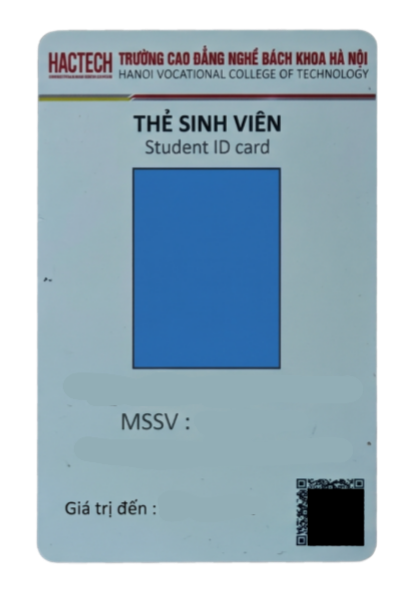

# REC Hactech (QRSV Hactech) 📱🎓

> **Lưu ý:** Ứng dụng được phát triển nhằm mục đích **thử nghiệm tính năng phục vụ đồ án tốt nghiệp**.

Ứng dụng di động (hỗ trợ Android) giúp quét mã QR và đọc NFC trên thẻ sinh viên trường Cao đẳng Nghề Bách Khoa Hà Nội (HACTECH) nhằm hỗ trợ tra cứu thông tin sinh viên và văn bằng.

---

## ⚠️ Lưu ý quan trọng về loại thẻ hỗ trợ

Ứng dụng **chỉ hỗ trợ** thẻ sinh viên thỏa mãn các điều kiện sau:

* ✅ **ĐƯỢC HỖ TRỢ:** 
  * Thẻ sinh viên mẫu đứng có **chứa mã QR** (như **Ảnh 2**).
  * Thẻ sinh viên nội bộ **không liên kết với đơn vị ngân hàng**.
* ❌ **KHÔNG HỖ TRỢ:**
  * Thẻ sinh viên mẫu cũ / mẫu ngang sử dụng mã vạch (Barcode) truyền thống (như **Ảnh 1**).
  * Các loại thẻ sinh viên liên kết với đơn vị ngân hàng hoặc thẻ không có mã QR.

### Bảng đối chiếu mẫu thẻ:

| Loại thẻ | Tình trạng | Hình ảnh minh họa |
| :--- | :---: | :---: |
| **Thẻ mẫu cũ** - Định dạng ngang - Mã vạch Barcode truyền thống | ❌ **KHÔNG HỖ TRỢ** |  |
| **Thẻ mẫu mới** - Định dạng đứng - Có mã QR góc dưới - Không liên kết ngân hàng | ✅ **ĐƯỢC HỖ TRỢ** |  |

---

## ✨ Các tính năng chính

* 📷 **Quét mã QR:** Quét trực tiếp qua Camera hoặc chọn ảnh chụp thẻ từ thư viện máy.
* 💳 **Đọc thẻ NFC:** Chạm thẻ sinh viên vào mặt lưng điện thoại để đọc mã thẻ tự động.
* 🔍 **Tra cứu thông tin sinh viên:** Hiển thị thông tin sinh viên sau khi quét mã thành công.
* 📜 **Tra cứu văn bằng:** Hỗ trợ kiểm tra thông tin văn bằng tốt nghiệp.

---

## 🛠️ Công nghệ sử dụng

* **Framework:** .NET MAUI (.NET 10)
* **Ngôn ngữ:** C# / XAML
* **Thư viện chính:**
  * `ZXing.Net.Maui` / `ZXing.Net`: Xử lý quét và giải mã mã QR.
  * `SkiaSharp`: Xử lý hình ảnh.
  * `TesseractOcrMaui`: Nhận diện ký tự quang học (OCR).
  * `Android.Nfc`: Đọc chip NFC trên các thiết bị Android hỗ trợ.

---

## 🚀 Cài đặt & Thử nghiệm

1. Tải file cài đặt `app-release.apk` tại mục [Releases](../../releases).
2. Mở và cài đặt trên điện thoại Android (khuyến nghị Android 8.0 trở lên, máy có hỗ trợ NFC).
3. Cấp quyền Camera khi ứng dụng yêu cầu để quét mã QR.

